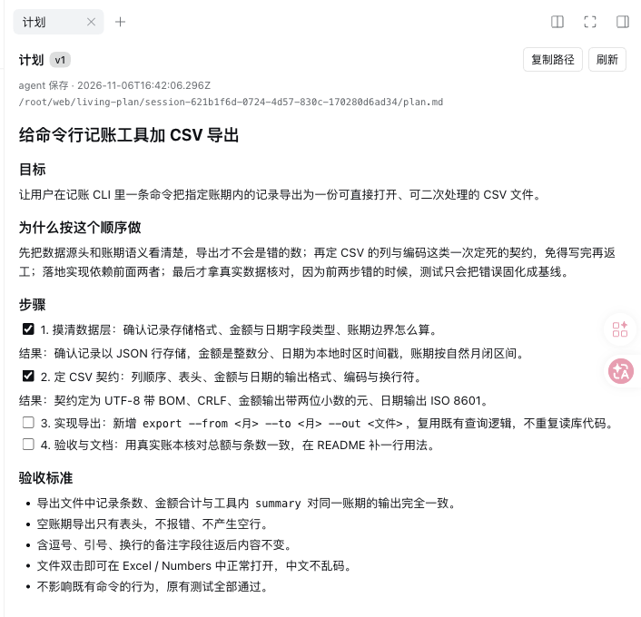
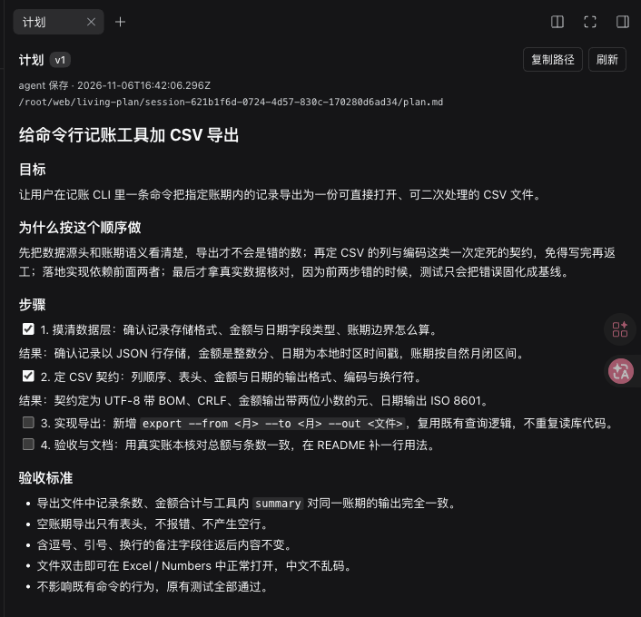

# dsh-living-plan

English · [中文](README.zh.md)

> A DeepSeek Harness (DSH) plugin with a host half and a web client half. Not an agent skill.

**Gives every DSH session a living plan**: one Markdown file that the model writes before it starts and keeps up to date while it works. Every save becomes a new version and is posted into the conversation; after a compaction it is posted again, with the user's own words that the compaction replaced quoted verbatim. Through long sessions, repeated compaction and changes of mind, the model keeps working towards what the user wants **now**.

It fills the gap between the built-in `/plan` (a one-off review) and `goal` (a one-line target): **where a long task stands now and what comes next**.

- Version: 0.3.1 ([CHANGELOG](CHANGELOG.md))
- Verified on DSH 0.2.2-rc.1 (desktop app, `dsh web`, headless, PTC mode)
- License: MIT

<p>


</p>

The 「计划」 (Plan) panel in the right sidebar: current version, who changed it, the file path, the rendered plan, and older versions below. Follows the app's light and dark themes. (The UI and the prompt text are in Chinese.)

## Why

The built-in `/plan` is a review gate: once approved, the plan lives only in a tool call, has no versions, and is not re-injected into later requests. `goal` keeps a single sentence, not "what is done, what is next, what has been decided". After a compaction or a hand-over, the model has to guess from a summary.

dsh-living-plan keeps the plan in a **fixed per-session file**:

- the model always holds the latest version: posted when it changes, posted again after a compaction;
- every change is a version, and old versions stay readable;
- you can edit the file yourself, and the next step picks up your edit;
- DSH's compaction summary paraphrases the user in English; the plugin restores the replaced user words verbatim;
- when the user speaks and the plan does not follow, the model is reminded to update it first;
- a read-only panel in the web UI shows it without hunting for the path.

## What it does

- **Fixed location**: `$DSH_HOME/living-plan/<session-id>/plan.md`, one per session, outside your workspace repository.
- **Posted into the conversation, not the system prompt**: the plan text arrives as a `living-plan` message when there is a new version (your edits included), when a compaction swallowed the last copy, or when the last copy is `refreshSteps` steps back. The system prompt holds only the fixed writing contract, so saving a plan never rewrites the cached prompt prefix.
- **Kept through compaction**: which version was posted and whether a compaction swallowed it are folded from the session log (a DSH compaction must list every node it shadows), so restarts and resumes agree.
- **The user's words, verbatim**: user messages a compaction replaced ride along with the plan (the first one as fully as the budget allows, the rest clipped, total capped). Before a compaction they are in the conversation already and are not repeated.
- **Change-of-mind reminder**: if the user spoke and the plan has not moved after `remindAfterSteps` steps, a short reminder quotes the user and asks the model to update the plan first. A long session with no plan gets one reminder too.
- **Shape hints**: `plan_write` returns hints when the saved plan lacks a quote of the user's words or acceptance criteria (the save still goes through).
- **Versions**: each `plan_write` or edit by you bumps the version; old ones go to `history/vNNNN.md`.
- **You can edit it**: editing `plan.md` directly is a supported path; the next step posts it as a new version.
- **Write guard**: `plan_write` is accepted only if the model has seen the current version. If the file changed in between (for example you edited it), the write is refused with `PLAN_STALE` and the model must `plan_read` first, so it never overwrites your edit with a stale copy.
- **Subagents** keep no plan by default (`includeSubagents: false`).

The prompt gives a skeleton (title, the user's words quoted with `>`, goal and acceptance, decided, dropped, progress, next) and tells the model to write a plan unprompted for anything bigger than a quick question or a small fix, to put the user's latest words above older plan text, to update the plan before acting on a change of mind, to check the acceptance list before calling the work done, and not to write one for trivial turns. This is a soft contract, not a hard gate.

## Install

Requirements: DSH 0.2.2-rc.1 (others untested; 0.3.0 needs the `sessionProjections` service); quit the desktop app before installing.

```sh
dsh plugin --profile <profile> add github:doctorllll/dsh-living-plan#v0.3.1
```

The desktop app's `desktop` profile only accepts the CLI bundled with the app (a `dsh` on your PATH refuses with `managed exclusively by the Electron application`). On macOS:

```sh
"/Applications/DeepSeek Harness.app/Contents/Resources/runtime/cli/bin/dsh" \
  plugin --profile desktop add github:doctorllll/dsh-living-plan#v0.3.1
```

Reopen the app afterwards. The plugin applies to **new sessions** in that profile.

**Only some profiles.** The plugin is host-level: once installed in a profile, every session there gets the plan section, including sessions of custom presets. If a profile should not have it (say, a chat bot whose sessions have no `plan_*` tools), disable it in that profile's or home's `cordis.patch.yml`:

```yaml
- id: living-plan
  disabled: true
```

**Upgrade**: re-run `plugin add` with the new tag and reopen the app. **Uninstall**: `dsh plugin --profile <profile> remove dsh-living-plan`; plan files under `$DSH_HOME/living-plan/` are kept.

## Configuration

Override by id in the profile's `cordis.patch.yml`:

```yaml
- id: living-plan
  config:
    includeSubagents: false   # true = subagent sessions keep their own plans
    maxPlanBytes: 24576       # plan size limit; plan_write over it returns PLAN_LIMIT
    historyLimit: 50          # how many old versions to keep; 0 = none
    placement: message        # message = post into the conversation; system = the 0.2.x behaviour (plan in the system prompt)
    refreshSteps: 40          # re-post after this many steps; 0 = never
    remindAfterSteps: 3       # remind when the plan has not moved this many steps after the user spoke; 0 = off
    noPlanAfterSteps: 8       # remind once when a session has no plan after this many steps; 0 = off
    ledgerMaxBytes: 6144      # cap on the verbatim user words posted with the plan
    sectionOrder: 950         # where the contract section sits in the prompt
    home: null                # defaults to $DSH_HOME, then ~/.dsh
```

`placement: system` is the fallback switch: one line and a restart bring back the old behaviour (the reminders keep working).

## Tools

- `plan_read` — returns `markdown`, `version`, `bytes`, `path`, `exists`, `truncated`, and marks this version as seen.
- `plan_write({ markdown, note? })` — replaces the whole plan and creates the next version; may return `hints`. Fails with `PLAN_STALE` (changed since the model saw it; read first) or `PLAN_LIMIT` (too large).

In PTC mode the model can only call `run_code` directly, so it calls them from code: `await tools.plan_write({ markdown: "# Plan\n\n- [ ] first step" })`. Sessions created before installing may cache the old tool declarations; open a new session.

## Storage

```text
$DSH_HOME/living-plan/<session-id>/
├── plan.md          current text
├── meta.json        version / hash / bytes / updatedAt / updatedBy
└── history/
    ├── v0001.md
    └── index.jsonl  only when plan_write passed a note
```

Directories are 0700 and files 0600; writes go through a temp file and `rename`. The session id is sanitised before it becomes a path.

## Panel

The 「计划」 card in the right sidebar shows the current version, update time, whether the agent or you changed it, and the path; renders headings, task checkboxes, code, quotes and tables; refreshes every 5 seconds; lets you open any older version read-only; and has copy-path and refresh buttons. It reads the local route `GET /api/living-plan?sessionId=…[&version=N]`, never marks a version as seen for the model, and only serves live sessions.

## Sessions, forks, subagents

| Case | Plan injected | Plan file | plan_write |
|---|---|---|---|
| New session | once written | empty, created on demand | yes |
| Same session resumed | yes (not re-posted while still in the conversation) | continues | yes |
| Branch / moved to another workspace (DSH copies it into a new session id) | yes | **inherits the parent's plan as shown at the copy**, as its version 1 | yes |
| Subagent (default) | no | none | no |

`/plan` still works as the official review gate; after approval, have the model save the same plan with `plan_write`.

## Troubleshooting

| Symptom | Cause / fix |
|---|---|
| `profile "desktop" is managed exclusively by the Electron application` | You used the `dsh` on your PATH; use the app's bundled CLI |
| No 「计划」 in the right sidebar | Restart the app and open a new session |
| Model says it has no `plan_write` | In PTC call `tools.plan_write` from `run_code`; open a new session |
| `PLAN_STALE` | The file changed after the model saw it; `plan_read`, then write |
| `PLAN_LIMIT` | The plan exceeds `maxPlanBytes`; trim it to what a successor needs |
| Panel shows `session-not-live` | The session is not running; the panel only serves live sessions |

## Development

```sh
npm test            # 24 unit tests on the store and the delivery rules (no DSH needed)
node --check lib/index.js lib/client.js
```

| File | Content |
|---|---|
| `lib/core.js` | storage, versions, hashes, external-edit detection, shape hints (no DSH dependency) |
| `lib/deliver.js` | session projection, when to post and remind, message rendering (no DSH dependency) |
| `lib/index.js` | host plugin: contract section, posting on `agent/pre-step`, `plan_read` / `plan_write`, HTTP route |
| `lib/client.js` | web client: the panel, a hand-written module-loader bundle using `react` / `react/jsx-runtime` only, no build step |
| `cordis.patch.yml` | bundle mount row and defaults |

## Known limits

- The panel is read-only (no inline edit or diff); change the plan with `plan_write` or by editing the file.
- Whole-file replacement only, within a 24 KB default limit.
- A copied session finds its parent through the plan messages it inherited; a parent that never posted a plan (0.2.x sessions) leaves nothing to inherit.
- Not per preset: the section goes into every session of the profile; disable the plugin where it is not wanted.
- Depends on DSH host APIs (`agent/created`, `agent/pre-step`, `agent.ctx.systemPrompt.section`, `sessionProjections`, `session.eventAt`, the `sourceEventSeqs` of compaction replacements, `ctx.tools.register`, `webServer.register`); re-test after DSH upgrades.
- The verbatim ledger takes only `source.kind: user` messages (what the user typed, headless or scheduled task text).
- Soft contract: whether the model writes a plan unprompted is its own judgement.

## Feedback

Please open an [issue](https://github.com/doctorllll/dsh-living-plan/issues).

## License

MIT, see [LICENSE](LICENSE).
