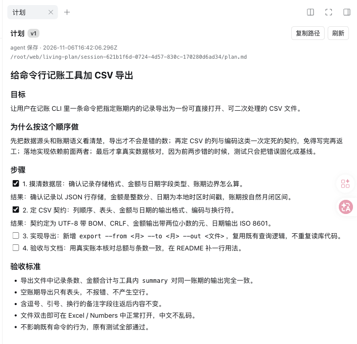
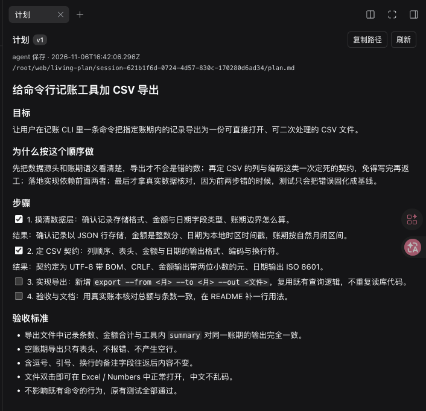

# dsh-living-plan · 活计划

[English](README.md) · 中文

> DeepSeek Harness（DSH）插件，由宿主半和网页客户端半组成；不是 Agent Skill。

给每个 DSH 会话一份**活计划**：一份 Markdown，模型在动手前写、工作中改；每次保存成为新版本，并作为一条消息贴进对话；上下文被压缩后自动重贴，被压缩掉的用户原话逐字附在后面。长会话、多次压缩、用户中途改主意之后，模型仍然对着用户**现在**要的东西干活。

它补的是官方 `/plan`（一次性评审）和 `goal`（一句目标）之间的空档：**长任务的“现在在哪、下一步做什么”**。

- 版本：0.3.1（[CHANGELOG](CHANGELOG.md)）
- 已验证 DSH：0.2.2-rc.1（桌面 App、网页版 `dsh web`、headless、PTC 模式）
- License：MIT

<p>


</p>

右栏「计划」面板：当前版本、谁改的、文件路径、渲染后的计划，下面是历史版本。深色 / 浅色跟随 App 主题。

## 目录

- [为什么需要它](#为什么需要它)
- [它做什么](#它做什么)
- [工作方式](#工作方式)
- [安装](#安装)
- [配置](#配置)
- [模型工具](#模型工具)
- [存储结构](#存储结构)
- [面板 UI](#面板-ui)
- [PTC、子代理与分支](#ptc子代理与分支)
- [已验证](#已验证)
- [排障](#排障)
- [开发与测试](#开发与测试)
- [已知边界与路线](#已知边界与路线)

## 为什么需要它

DSH 自带的 `/plan` 是一个一次性评审门：批准之后，计划正文只留在工具调用记录里，没有版本，也不会在每次请求时重新注入。`goal` 只保存一句目标，不保存“现在做到哪、下一步是什么、哪些已经拍板”。

于是长任务一旦被压缩或换人接手，模型就得从摘要里猜。`dsh-living-plan` 把计划做成一份**固定路径的会话文件**：

- 模型一直能看到最新版：改了就贴，压缩后重贴；
- 每次修改都是一版，旧版可查；
- 用户可以直接改文件，下一步模型就能看到；
- DSH 的压缩摘要是英文转述，用户原话会丢；插件把被压缩掉的原话逐字补回来；
- 用户说了话、计划却没跟着改，提醒模型先改计划；
- Web 右栏有一个只读面板，用户不必去翻文件路径。

## 它做什么

- **固定位置**：`$DSH_HOME/living-plan/<session-id>/plan.md`，按会话隔离，不写进工作区仓库。
- **贴进对话，不改系统提示**：计划正文以一条 `living-plan` 消息贴进对话。何时贴：有新版本（含用户手改）、上一份被压缩吞掉、距上次贴出已满 `refreshSteps` 步。系统提示里只有不变的写作契约，改计划不会打掉前缀缓存。
- **压缩后不丢**：“贴过哪一版、有没有被压缩吞掉”从会话日志推出（DSH 的压缩替换必须列出被遮蔽的每个节点），App 重启、续跑都一样。
- **用户原话账本**：被压缩掉的用户消息逐字附在计划后面一起贴（首条尽量全文，其余截断，总量有上限）；压缩前原话本来就在对话里，不重复贴。
- **改口提醒**：用户说话后计划没更新、又过了 `remindAfterSteps` 步，贴一次短提醒，引用户那句话，要求先改计划再继续；长会话一直没有计划，也提醒一次。
- **结构提示**：`plan_write` 存下的计划缺“用户原话引用”或“验收标准”时，在返回里提示（不拒写）。
- **版本历史**：每次 `plan_write` 或用户直接改文件，版本 +1，旧版留在 `history/vNNNN.md`。
- **用户可改**：直接编辑 `plan.md` 是支持路径，不是篡改；下一步会把它当作新版本贴出。
- **写前校验**：`plan_write` 只接受“模型已经看过当前版本”的写入；如果文件在两步之间被改过，写入被拒，提示先 `plan_read`。这是防止覆盖用户改动的闸门。
- **子代理默认不建计划**：`includeSubagents: false`，主会话的计划是唯一工作台；需要时可打开。
- **Web 面板**：右栏 Guides「计划」，看当前版本、历史版本和文件路径。

## 工作方式

```
模型请求组装
  ├─ System prompt section: living-plan:plan    （固定文本：写作契约 + 文件路径）
  └─ agent/pre-step
       ├─ 读取 plan.md（外部改动记为新版本）
       ├─ 会话投影 livingPlan：贴过哪一版、是否被压缩吞掉、
       │   被压掉的用户消息、用户最后一句之后走了几步
       ├─ 需要时贴「你的计划（living plan）第 N 版」+「用户原话」
       ├─ 需要时贴「计划提醒」
       └─ 标记这一版为“模型已看过”

plan_read / plan_write
  └─ PlanStore
       ├─ plan.md          当前正文
       ├─ meta.json        version / hash / bytes / updatedAt / updatedBy
       └─ history/vNNNN.md 每次保存的旧版

Web 右栏「计划」
  └─ GET /api/living-plan?sessionId=... [&version=N]
       └─ 同一个 PlanStore（只读，不标记已看过）
```

### 写作契约

提示词里固定写清（节选）。计划骨架：标题下用 `>` 原样引用户的需求，然后「目标与验收」「已定」「已作废」「进度」「下一步」。

> 开工前自己写，不用等用户要求：超过一次问答或小改动的工作，先用 `plan_write` 写出计划，再按顺序做。
>
> 用户最新的话优先于计划里的旧内容。用户改口时先改计划再动手：旧的挪进「已作废」，新的连原话写进「已定」。
>
> 收工前逐条对照「目标与验收」，没满足的不说完成。
>
> 用 `plan_write` 整份替换；写之前如果用户可能刚改过，先 `plan_read`。
>
> 不要写成流水账：完成的步骤删掉过程只留结果，同一件事只写一处。
>
> 不要为一次问答、小查看、小修写计划；一轮下来没有任何推进也不要改。

### “已看过”闸门

`plan_write` 比较两个哈希：

- 当前文件的哈希；
- 模型最后一次看到的那一版的哈希（`seenHash`，贴出或确认对话里已有当前版时记下）。

两者不一致，说明文件在模型看到之后被用户改过，写入返回 `PLAN_STALE`，模型必须先 `plan_read`。这避免模型拿旧上下文覆盖用户刚写的内容。

注意：这是**软约束的补强**，不是“没写计划就不准调工具”的硬闸。模型会不会在任务开始时主动写，仍取决于它对任务复杂度的判断；重要长任务可以在开头补一句“先写 plan”。

## 安装

### 前置

- DeepSeek Harness 0.2.2-rc.1（其他版本未验证；0.3.0 需要 `sessionProjections` 服务）
- Node.js 22.19+ 或 24+（DSH 自带的运行时即可）
- 桌面 App 安装前必须完全退出

### 桌面 App（desktop profile）

`desktop` profile 只认 App 自带的 CLI。PATH 里的 npm 全局 `dsh` 会报：

```text
error: profile "desktop" is managed exclusively by the Electron application
```

正确命令（macOS）：

```sh
"/Applications/DeepSeek Harness.app/Contents/Resources/runtime/cli/bin/dsh" \
  plugin --profile desktop add github:doctorllll/dsh-living-plan#v0.3.1
```

装完重开 App。插件随 profile 加载，对所有**新会话**生效。

### 其他 profile（网页版、TUI 等）

```sh
dsh plugin --profile <profile 名> add github:doctorllll/dsh-living-plan#v0.3.1
```

### 只想在部分 profile 里用

插件是宿主级的：装进一个 profile 后，这个 profile 里**每个会话**（包括自定义 preset 的会话）都会被注入计划段。比如有一个只给聊天机器人用的 profile、它的会话里根本没有 `plan_*` 工具，就在那个 profile（或 home）的 `cordis.patch.yml` 里关掉：

```yaml
- id: living-plan
  disabled: true
```

### 升级

把命令里的 `#v0.3.1` 换成新版本的标签重新 `plugin add`，重开 App。从本地目录安装（`add <路径>`）时，`git pull` 后重开 App 即生效。

### 卸载

```sh
"/Applications/DeepSeek Harness.app/Contents/Resources/runtime/cli/bin/dsh" \
  plugin --profile desktop remove dsh-living-plan
```

卸载不会删已生成的 `$DSH_HOME/living-plan/` 计划文件；需要时手动清理对应会话目录。

## 配置

在 profile 的 `cordis.patch.yml` 里按 id 覆盖：

```yaml
- id: living-plan
  config:
    includeSubagents: false   # true = 子代理会话也各自建计划
    maxPlanBytes: 24576       # 计划上限（字节）；超了 plan_write 返回 PLAN_LIMIT
    historyLimit: 50          # 保留最近多少版；0 = 不保留旧版
    placement: message        # message = 贴进对话；system = 0.2.x 旧行为（正文进系统提示，每次改都打掉缓存）
    refreshSteps: 40          # 距上次贴出满多少步重贴一次；0 = 不重贴
    remindAfterSteps: 3       # 用户说话后计划多少步没动就提醒；0 = 关
    noPlanAfterSteps: 8       # 会话多少步还没计划就提醒一次；0 = 关
    ledgerMaxBytes: 6144      # 用户原话账本上限（字节）
    sectionOrder: 950         # 契约段位置
    home: null                # 默认 $DSH_HOME，再退到 ~/.dsh
```

默认值在 `cordis.patch.yml` 的 bundle insert 行里。`placement: system` 是回退开关：不用重装，改一行重启即可回到旧行为（提醒仍然有效）。

## 模型工具

### `plan_read`

读当前计划，并把这一版标记为“模型已看过”。

- 参数：无
- 返回：`markdown`、`version`、`bytes`、`path`、`exists`、`truncated`
- 计划不存在时返回空正文和 `exists: false`

### `plan_write`

整份替换计划，生成下一版。

- 参数：
  - `markdown`（必填）：完整 Markdown，建议以短标题开头
  - `note`（可选）：写进 `history/index.jsonl` 的变更说明，不进入计划正文
- 返回：`version`、`bytes`、`path`；缺用户原话引用或验收标准时另有 `hints`（只是提示，已保存）
- 失败：
  - `PLAN_STALE`：文件在模型看到后被改过，先 `plan_read`
  - `PLAN_LIMIT`：超过 `maxPlanBytes`，先压缩计划

### PTC 模式

在 PTC 模式里，模型只能直接调用 `run_code`，所以工具要从程序内调：

```ts
await tools.plan_write({ markdown: "# 计划\n\n- [ ] 第一步" })
const plan = await tools.plan_read({})
```

新会话的 `tools:sdk` 会声明这两个工具；**安装前就已存在的会话**可能缓存旧声明，看不到签名但 `tools.plan_*` 实际可调用，开新会话即可拿到完整声明。

## 存储结构

```text
$DSH_HOME/living-plan/<session-id>/
├── plan.md                 当前正文（Markdown）
├── meta.json               version / hash / bytes / updatedAt / updatedBy
└── history/
    ├── v0001.md
    ├── v0002.md
    └── index.jsonl         仅当 plan_write 传了 note
```

- 目录权限 0700，文件 0600；写入走临时文件 + `rename`，避免半截文件。
- `session-id` 会做字符清洗和长度截断，防止路径注入。
- 计划存在 `$DSH_HOME` 下，不进工作区 git 仓；如果项目需要版本化，可自行把 `plan.md` 复制进仓或做软链。

## 面板 UI

右栏 Guides 里的「计划」卡片：

- 当前版本、更新时间、`agent 保存` / `用户修改`、文件路径；
- Markdown 渲染：标题、待办勾选框、代码块、引用、表格；
- 每 5 秒自动刷新；
- 历史版本 chips，点任意一版只读查看，顶部有「回到当前」；
- 「复制路径」「刷新」。

面板读本机路由 `GET /api/living-plan`，只读；它不会替模型标记“已看过”。路由只服务当前存活的会话，会话不存在返回 `session-not-live`。

## PTC、子代理与分支

| 场景 | 计划是否注入 | 计划文件 | 能否 plan_write |
|---|---|---|---|
| 新会话 | 写了才贴 | 空，按需创建 | 是 |
| 同会话续跑 | 是（对话里已有就不重贴） | 接着原版本 | 是 |
| 分支 / 移到别的工作区（DSH 复制出新会话、给新编号） | 是 | **自动继承原会话当时那一版**，作为本会话第 1 版 | 是 |
| 子代理（默认） | 否 | 不创建 | 否，返回“subagent session does not keep a living plan” |

- **分支 / 移动会话**：DSH 复制出的新会话有新的 `session-id`，而计划按 id 存。0.3.1 起，新会话第一次运行时，插件从继承来的对话里找到原会话最后贴出的那一版（按 hash 在原会话历史里找；找不到就用原会话当前版并注明），复制成本会话第 1 版（`updatedBy: inherited`，`meta.inheritedFrom` 记来源），贴出时说明"计划从原会话第 N 版带过来"。原会话没有计划、或本会话已有自己的计划（包括用户清空过）时不继承。之后两边各改各的。
- **子代理** 默认不建计划；把 `includeSubagents` 设为 `true` 后每个子代理会有自己的计划文件。
- **`/plan`** 仍是官方评审门；评审通过后让模型把同一份计划用 `plan_write` 落盘即可，两者不互斥。

## 已验证

2026-11-09，0.3.1：网页版临时 home 实测分支——原会话计划第 2 版，点「在新对话中分支」后新会话第一步就贴出"计划从原会话第 2 版带过来"，内容与原会话 v2 逐字相同；模型接着改出本会话 v2、v3，并能说清计划来历。单测 27 项。

2026-11-09，0.3.0，DSH 0.2.2-rc.1（临时 DSH_HOME，真模型 `auto/deepseek-v4.1-flash`）：

- headless 6 轮对话，压缩阈值调到很小，压缩 4 次：系统提示全程一条、没被替换；每次压缩后下一步重贴最新版计划并附被压掉的用户原话；最后问“我最开始怎么说的、中途改了什么”，两句原话逐字答对；
- 用户改口：一次模型下一步就改了计划并把旧方案写进「已作废」；一次 3 步没动计划，出现一次提醒，随即补进计划；
- 任务进行中手改 `plan.md`：下一步贴出新版（`用户改了计划`）；
- 缓存：改计划后下一步命中多为 94–98%（0.2.x 在 system 段里时同类请求 0–1%）；压缩后另有两次约 45%，同期手改计划的对照为 94%，不是贴计划本身所致；
- 网页版：对话视图不显示计划消息，右栏面板照常；标准模式与 PTC 模式（`run_code` 里 `tools.plan_write`）都正常贴出；
- 单测 24 项全过。

2026-11-06，DSH 0.2.2-rc.1：桌面 App 与网页版装上即用；面板在深色 / 浅色主题下都清楚；PTC 新会话里 `tools.plan_write` 正常；从 GitHub 标签安装（`github:doctorllll/dsh-living-plan#v0.2.1`）实测可装。

2026-11-05，DSH 0.2.1-rc.5：

Host / headless：

- 新会话调用 `plan_write` 生成 v1，`plan.md`、`meta.json`、`history/v0001.md` 正确；
- 同会话 `--session-id` 续跑生成 v2；
- 用户直接改 `plan.md`，下一次请求记为 v3（`updatedBy: user`），模型逐字复述新增行；
- `plan_read` 返回 v3、139 字节。

Web 面板（一次性 web profile，ego-lite 实测）：

- 右栏 Guides 出现「计划」，显示 v2、勾选框、路径；
- 历史 chips 出现 v2/v1，点 v1 显示「正在看历史版本 v1」且内容没有 v2 的进展行；
- 直接改 `plan.md` 后 5 秒变 v3、`用户修改`、历史 3 版。

PTC / 桌面：

- `desktop` profile 安装 0.2.0，App 重启后新会话提示里出现 living plan section；
- 一次性 web profile 强制 `default: ptc`，新会话模型在 `run_code` 里调 `plan_write`，v1 成功、554 字节；右栏面板同步显示；
- 旧会话可能缓存旧 `tools:sdk` 声明，开新会话即可。

单测：`npm test`，11 项全过（空计划、超限、外部改动、陈旧写入、删除、历史窗口、按会话隔离、历史列表、按版本读取、客户端 bundle 结构）。

## 排障

| 现象 | 原因 / 处理 |
|---|---|
| `profile "desktop" is managed exclusively by the Electron application` | 用了 PATH 里的 npm `dsh`；改用 App 自带 CLI（见安装） |
| 装完右栏没有「计划」 | App 没重启，或当前是安装前的老会话；重启并新开会话 |
| 模型说没有 `plan_write` 工具 | PTC 下要 `tools.plan_write`；新会话再看 `tools:sdk` 声明 |
| `PLAN_STALE` | 文件在模型看到后被改过；先 `plan_read` 再写 |
| `PLAN_LIMIT` | 计划超过 `maxPlanBytes`；压缩计划，只留接手续作所需 |
| 面板 404 / `session-not-live` | 该会话不在运行；面板只读存活会话 |
| 计划读不了 | 检查 `$DSH_HOME/living-plan/<session-id>/plan.md` 权限；插件会退化为“计划文件读不了”提示 |

## 开发与测试

```sh
npm test
node --check lib/index.js
node --check lib/client.js
```

结构：

```text
lib/core.js        存储、版本、哈希、外部改动检测、计划结构提示（无 DSH 依赖，可单测）
lib/deliver.js     会话投影、何时贴 / 提醒的判定、消息渲染（无 DSH 依赖，可单测）
lib/index.js       Host 插件：契约段、pre-step 贴计划、plan_read/plan_write、HTTP 路由
lib/client.js      Web 客户端：右栏面板，手写 __ModuleLoader__ bundle
test/*.test.js     24 项单测
cordis.patch.yml   bundle 挂载行与默认配置
```

客户端没有构建步骤：`lib/client.js` 是符合 DSH Web module loader 的普通 JS bundle，只用 `react` / `react/jsx-runtime`；改它不需要 tsc/vite。

## 已知边界与路线

- **面板只读**：不做行内编辑和 diff；改计划走 `plan_write` 或直接编辑文件。
- **整份替换**：没有局部 patch；24KB 上限内够用，超了要模型自己收束。
- **继承靠对话里贴过的计划消息认出原会话**：原会话从没贴过计划（比如 0.2.x 时代的会话），分支出来就没有可继承的。
- **依赖 DSH 内部 API**：`agent/created`、`agent/pre-step`、`agent.ctx.systemPrompt.section`、`sessionProjections`、`session.eventAt`、压缩替换的 `sourceEventSeqs`、`ctx.tools.register`、`webServer.register`；rc 升级后需要回归。
- **不分 preset**：契约段和计划消息进 profile 里的每个会话，暂时没有"只对某些 preset 生效"的开关；不需要的 profile 用 `disabled: true` 关掉（见安装）。
- **原话账本只收 `source.kind: user` 的消息**（界面里打的字、headless / 定时任务的任务文本）；其他来源的合成消息不收。
- **软约束**：模型是否主动写计划取决于任务判断，不是系统强制；要 100% 必写需要加工具调用前的硬闸。
- 路线：按 preset 开关；面板行内编辑 / 版本 diff；失败重试与更细的预算控制。

## 反馈

问题和建议请提 [Issue](https://github.com/doctorllll/dsh-living-plan/issues)。

## License

MIT。见 [LICENSE](LICENSE)。
